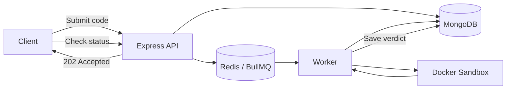

# Online Judge

<p align="center">
  A backend system that executes submitted code in isolated Docker containers and evaluates it against test cases.
</p>

<p align="center">
  
  
  
  
  
  
</p>

<p align="center">
  
</p>

## Overview

The system accepts code submissions through a REST API, processes them asynchronously using a Redis-backed job queue, and evaluates them in isolated Docker containers.

## Features

- JWT authentication
- Problems with sample and hidden test cases
- JavaScript and Python execution
- Isolated container for each test case
- Asynchronous processing with Redis and BullMQ
- Configurable worker concurrency
- Per-user submission rate limiting
- Verdicts for accepted solutions, incorrect answers, timeouts, memory limits, and runtime failures
- Integration tests for the submission workflow

## Architecture



1. The API stores the submission as `Pending`, queues a job, and returns `202 Accepted`.
2. The worker retrieves the job and executes each test case in a fresh Docker container.
3. The judge compares the output with the expected result and determines the verdict.
4. The final result is stored in MongoDB and can be retrieved through the API.

## Execution sandbox

Submitted code runs with resource restrictions to reduce the risk of malicious or resource-intensive programs.

| Protection | Configuration |
|---|---|
| Network isolation | `--network none` |
| Memory and CPU limits | `--memory`, `--memory-swap`, `--cpus` |
| Process limit | `--pids-limit` |
| Read-only filesystem | `--read-only` |
| Reduced privileges | `--cap-drop ALL`, `no-new-privileges` |
| Non-root execution | `--user 1000:1000` |
| Read-only source mount | `:ro` |

The judge enforces execution timeouts, limits captured output to 64 KB, and removes execution containers after use.

## API

| Method | Endpoint | Description |
|---|---|---|
| `POST` | `/auth/signup` | Register a user |
| `POST` | `/auth/login` | Authenticate and obtain a JWT |
| `GET` | `/problems` | List problems |
| `GET` | `/problems/:slug` | Get a problem and sample tests |
| `POST` | `/submissions` | Submit code |
| `GET` | `/submissions` | List the user's submissions |
| `GET` | `/submissions/:id` | Retrieve a submission's verdict |

Protected endpoints require an `Authorization: Bearer <token>` header.

## Getting started

**Prerequisites:** Node.js 20, Docker.

```bash
git clone https://github.com/iamaadii/online-judge.git
cd YOUR-REPO

npm install
cp .env.example .env
```

Configure the environment variables, then start the services and seed the database:

```bash
docker compose up -d --build
node src/seed.js
npm run worker
```

The API, MongoDB, and Redis run in Docker. The worker runs on the host and launches Docker containers to execute submissions.

Run the integration tests with the API and worker running:

```bash
npm test
```

## Design decisions

- **Asynchronous execution:** Keeps code execution separate from API request handling.
- **Fresh container per test case:** Reduces interference between test cases.
- **Hidden test cases:** Keeps private inputs and expected outputs out of public API responses.
- **Explicit resource limits:** Restricts CPU, memory, process count, execution time, and output.
- **Redis-backed rate limiting:** Limits each user to five submissions per minute.

## Future improvements
- [ ] C++ and Java (they need a compile step)
- [ ] Run the worker as a container with a safer setup (rootless Docker or gVisor)
- [ ] Per-language time and memory limits